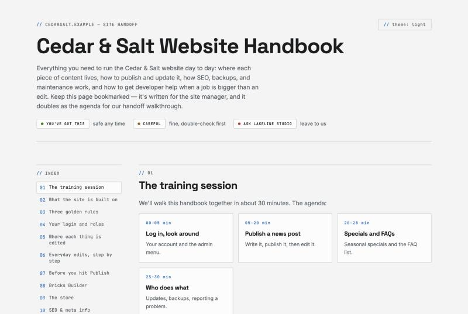
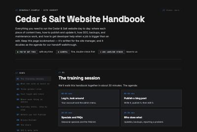

# The Client Handoff Handbook

A single-file HTML handbook template for WordPress devs who hand sites to clients.

You know the drill: the build is done, the client needs to run it, and "I'll just show
them real quick" becomes the same support emails forever. This template turns the
handoff into a document the client actually keeps open: where each thing is edited,
what's safe to touch, how to publish, and when to call you.

**[See the live demo](https://webwerksdev.github.io/client-handoff-handbook/)**: a
filled-in handbook for a fictional bakery, so you can click through the finished thing
before you fork it.

| Light | Dark |
|---|---|
|  |  |

## What's inside

Eighteen sections covering the whole ownership story, not just "here's the editor":

1. **The training session** - a 30-minute agenda the handbook doubles as
2. **What the site is built on** - the stack in client language
3. **Three golden rules**
4. **Login and roles** - including security basics
5. **Where each thing is edited** - a quick-reference map with WP Admin / Bricks /
   Developer badges, plus an annotated drawing of the admin menu
6. **Everyday edits, step by step** - with an annotated drawing of the post editor
7. **A pre-publish checklist** - interactive, remembers itself between visits
8. **Bricks Builder** - the safe-editing workflow, or the "why it's locked" variant
9. **The store** - WooCommerce orders and products, or the no-store variant
10. **SEO & meta** - SEO-plugin variant or meta-in-Bricks variant
11. **Tracking & the consent banner** - why clients must never paste a snippet
12. **Domain and email** - who renews what, and why email isn't the website
13. **Backups & restore** - client-managed or studio-managed variants
14. **Maintenance** - same two variants
15. **Keeping the site fast** - how not to spend the PageSpeed score you shipped
16. **Hands-off zones**
17. **When something breaks** - symptom-first triage table and a report template
18. **Glossary**

Everything is one self-contained HTML file: no build step, no dependencies beyond
Google Fonts, works from a file share or any static host. Light and dark theme with a
toggle, and it prints decently too.

## How to use it

1. Download [`client-handoff-handbook.html`](client-handoff-handbook.html).
2. Replace every `[[PLACEHOLDER]]` with your client's details (search for `[[`).
3. Each `<!-- variant -->` marker offers two or three versions of a section; keep the
   one that matches the build, delete the rest. Section numbers renumber themselves.
4. Prune the tables (content types, stack rows) to what the build actually has.
5. Rename it `<client>-website-handbook.html` and send it, or host it on the site.

The fastest route: hand this file and your project notes to your AI assistant and have
it do steps 2-4. The placeholders and variant markers are written to be machine-legible.

## Not on WordPress?

The examples are WordPress + Bricks + ACF because that's our stack, but the skeleton
(permissions map, golden rules, publish walkthrough, checklist, backups, consent,
domain/email boundaries, troubleshooting) fits any platform. Fork it and swap the
WP sections for your stack's equivalents.

## License

[MIT](LICENSE). Use it for client work, reskin it, ship it under your own brand. A
link back is appreciated, never required.

Made by [webwerks.dev](https://webwerks.dev), a web studio in San Antonio, TX.
